# 智能电商客服助手

界面已更新为「知序客服」企业服务工作台，保留原有业务核心与 API。改造说明、预览、验证结果及整体架构图见 [UI 改造交付说明](docs/ui-redesign/README.md)。

一个能查订单物流、答政策 FAQ、走退款子流程、从对话里挖知识补库，
还能微调一个主题分类器的完整电商智能客服系统。

功能逐块叠加、**不分支**：从一个纯对话接口起步，到收尾时是下面这整套东西。
每一块都留了 spec 和 plan（`docs/superpowers/`），这套先写 spec 再拆 plan 的流程可以当范本看。

## 能做什么

- 流式对话 + 结构化信息提取
- 五个业务工具，单轮 Function Calling
- 知识库：切块、嵌入、MySQL 与 Milvus 双写、从对话里挖问答对
- 混合检索、RRF 融合、重排、Query 改写、四策略评估
- LangGraph workflow 骨架 + 主力 Agent 的 ReAct 环
- 意图分流、指代消解、退款子流程的 interrupt / resume
- 上下文管理：滑窗、摘要、前缀缓存
- 工具系统：MCP 动态发现、统一执行引擎、审计日志
- Langfuse 自部署观测、数据飞轮、按意图的成本账
- 主题分类器：造语料、微调、阈值扫描、ONNX 推理服务

## 整体架构

一张图看完上下游：请求从**前端工作台**进来，经 **FastAPI 接口层**进到 **LangGraph 确定性工作流** ——
会话准备 → 指代消解 → 九类意图识别，再按「投诉/闲聊」「商品咨询」「订单/物流/人工」「退款/售后」四个出口分流。
商品咨询走知识检索（Query 改写 / 混合召回 / 重排与证据门控），**证据充分才进主力 Agent 的 ReAct 环**，
不足则兜底并记下知识缺口；退款要先校验订单归属，缺单号就 `interrupt` 让用户选单再 `resume`。
右侧是知识迭代与运营的闭环（源文档 / 历史会话 → 切块审核 → MySQL 与 Milvus 双写 → 用户负反馈与低置信度问题池 → 批处理查重 → 人工核准写回），
底部是支撑服务：MySQL、Milvus、SQLite checkpointer 与模型服务 / Langfuse。

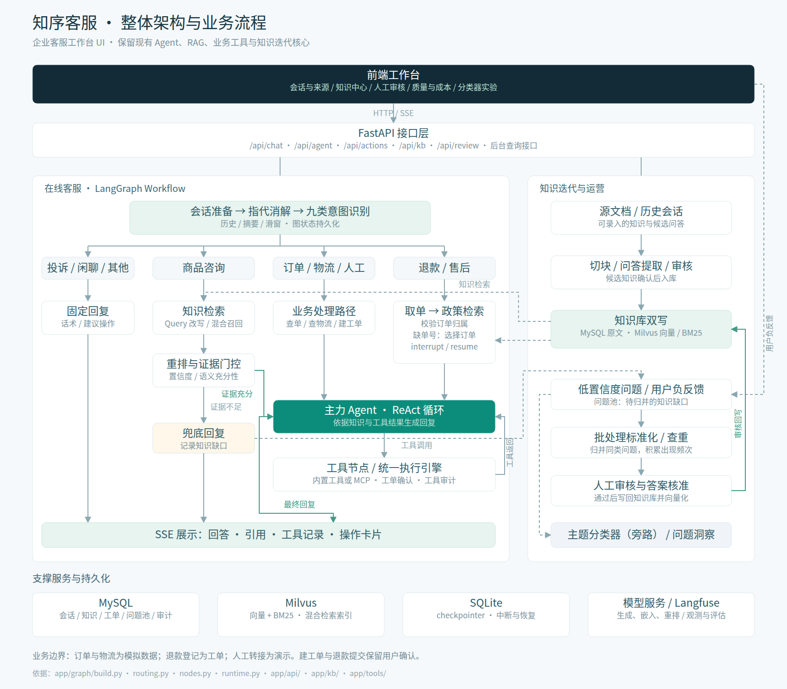

> 可编辑源文件与矢量版：[architecture.mmd](docs/ui-redesign/architecture.mmd) · [architecture.svg](docs/ui-redesign/architecture.svg)。
> 图上每个节点都对得上代码：`app/graph/{build,routing,nodes,runtime}.py` · `app/api/` · `app/kb/` · `app/tools/`。

## 界面速览

下面每一张都是**本机真实运行**的截图：真模型、真 MySQL / Milvus、真 MCP 工具，接口没有 mock。
界面是「知序客服」企业服务工作台，业务核心与 API 契约未变 ——
改造范围、文件组织与浏览器回归结果见 [UI 改造交付说明](docs/ui-redesign/README.md)。

### 会话工作台

三栏布局：左边是当前浏览器的会话记录，中间流式对话，右边是**本轮服务信息**（知识来源 / 业务工具 / 处理操作）。
工具回执、知识引用、待确认操作都长在对话流里，能点开、能回看。

<table>
<tr>
<td width="50%">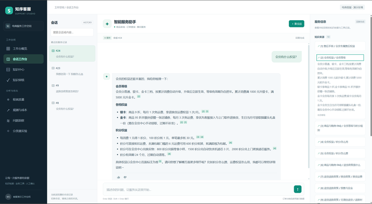<br>
<b>知识回答可溯源</b><br>问「会员有什么权益？」，回答按会员等级 / 各项权益 / 积分规则分组；正文里的 <code>[1][2]</code> 是可点角标，右栏 10 条来源精确到条款（如 <code>售后手册 / 会员专属售后权益</code>）。</td>
<td width="50%">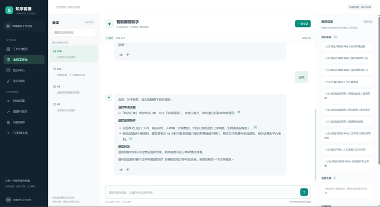<br>
<b>政策问答 + 快捷追问</b><br>只发「退款」两个字也能命中退款流程、适用条件与时效三段政策，答案带角标，并把下一步动作递到对话里。</td>
</tr>
<tr>
<td width="50%">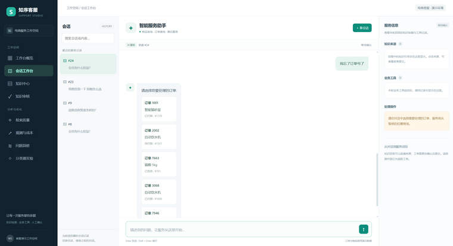<br>
<b>退款先选订单：中断 — 续跑</b><br>用户说「我忘了订单号了」，工作流在这里 <code>interrupt</code>，把该用户名下的订单渲染成卡片让用户点选；右栏「处理操作」提示服务已暂停、点选后从暂停处继续。</td>
<td width="50%">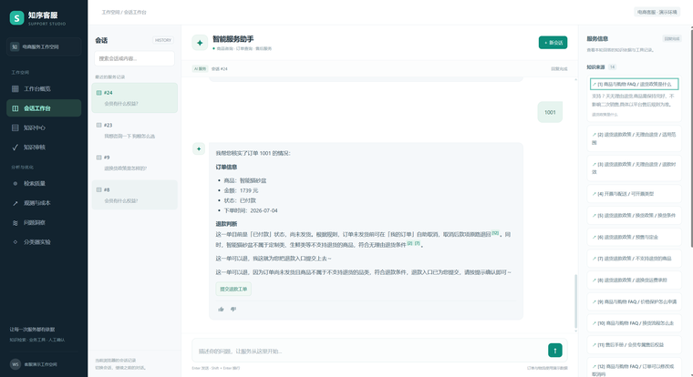<br>
<b>可退判断与工单预览</b><br>选定订单 1001 后，助手核对商品、金额、状态、下单时间，按规则给出是否可退及依据（引用政策条款），末尾给出「提交退款工单」按钮 —— 写操作前先让人确认。</td>
</tr>
<tr>
<td width="50%">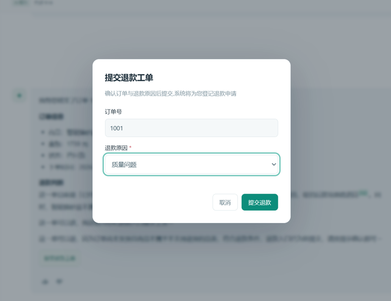<br>
<b>退款工单表单</b><br>点确认后弹出表单：订单号只读带入、退款原因必选，可取消。提交只是登记退款工单，不直接动支付。</td>
<td><b>三条确认闸门</b><br>选订单（<code>select_order</code>）、建工单（<code>confirm_ticket</code>）、退款表单（<code>submit_refund</code>）各对应一次人工确认，后端不替用户做决定；确认动作走 <code>/api/actions/*</code> 续跑同一张图。</td>
</tr>
</table>

### 知识与检索

知识怎么进库、进得对不对、检索召回的是不是该召回的那块 —— 这些在页面当场就能看见。

<table>
<tr>
<td width="50%">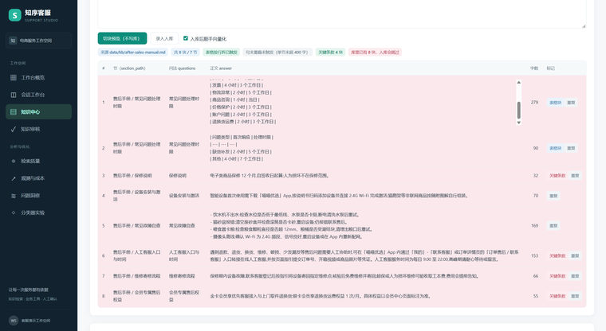<br>
<b>入库前先看切块</b><br>贴一份售后手册点「切换预览（不写库）」：8 块 / 7 节、重复按指纹拦截、关键条款 4 块、库里已有 8 块会跳过；每一块都带 <code>section_path</code>、问答与字数。</td>
<td width="50%">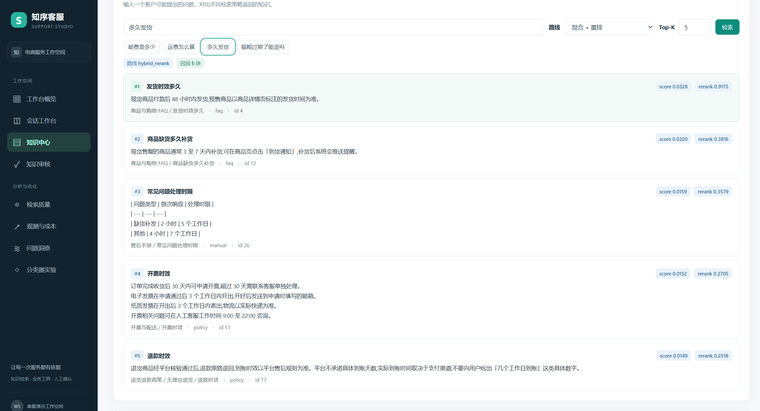<br>
<b>混合检索 + 重排自测</b><br>输入「多发发货」，走混合 + 重排返回 5 块，每块都带融合分与重排分（0.9775 / 0.3816…）和来源路径，召回对不对一眼能判。</td>
</tr>
<tr>
<td width="50%">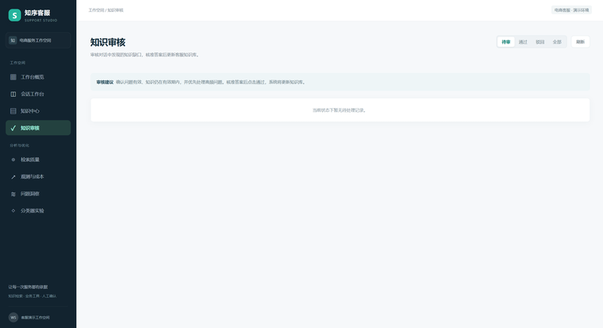<br>
<b>知识审核队列</b><br>低置信度问题与负反馈落进问题池，标准化查重后进这里人工核准；按待审 / 通过 / 驳回 / 全部筛选。</td>
<td width="50%">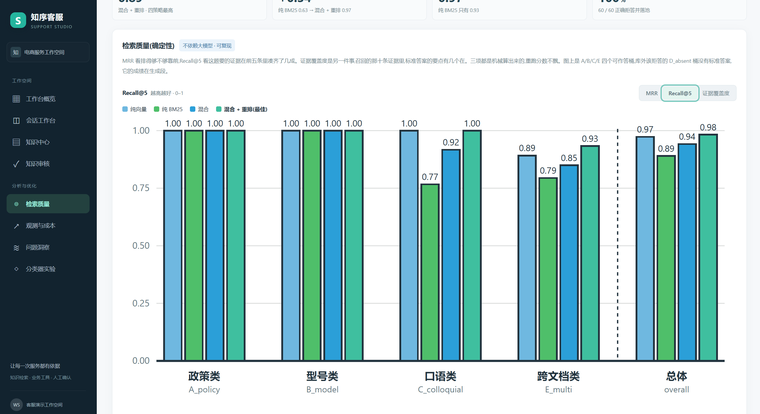<br>
<b>四策略对照</b><br>纯向量 / 纯 BM25 / 混合 / 混合+重排 在同一份 300 题评估集上的 Recall@5，分政策类、型号类、口语类、跨文档类逐类看；总体 0.97 / 0.89 / 0.94 / 0.98。</td>
</tr>
</table>

### 观测与实验

回答得好不好要能算账：花在哪些意图上、阈值定在哪、错在哪些边界上。

<table>
<tr>
<td width="50%">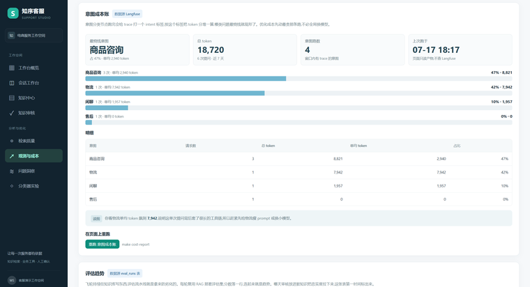<br>
<b>按意图的成本账</b><br>意图分流节点会先打一个 <code>intent</code> 标签，聚合后就能看出钱花在哪类问题上（商品咨询 47%、物流 42%…），优化时优先砍最贵的路。</td>
<td width="50%">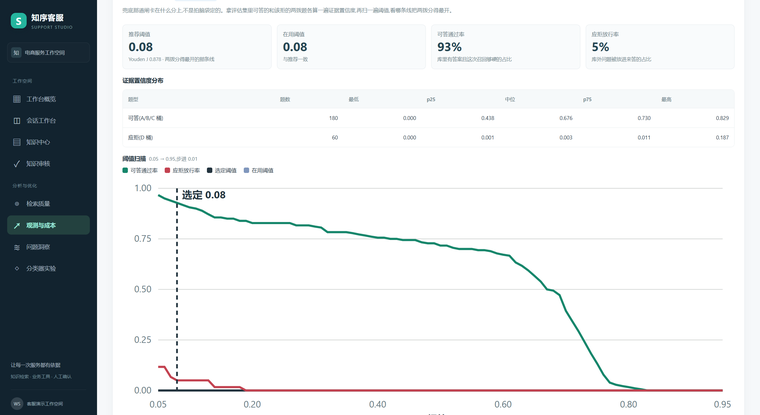<br>
<b>证据置信度阈值校准</b><br>阈值不是拍脑袋定的：在评估集上扫一遍，推荐值 0.08、可答通过率 93%、应拒放行率 5%；下面是可答 / 应拒两桶的分布与扫描曲线。</td>
</tr>
<tr>
<td width="50%">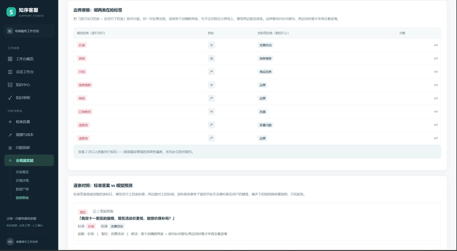<br>
<b>错例复核与边界摩擦</b><br>把「漏掉的类 ↔ 抢标签的类」按对数统计，逐条给出标准答案、模型预测与修法，用来定位分类器的边界问题、决定先补哪一类知识。</td>
<td><b>这些页面的入口</b><br>聊天 <code>/</code>、后台首页 <code>/admin</code>、知识中心 <code>/kb</code>、知识审核 <code>/review</code>、检索质量 <code>/rag-eval</code>、观测与成本 <code>/observability</code>、问题洞察 <code>/topics</code>、分类器实验 <code>/acceptance</code>。</td>
</tr>
</table>

> 截图为 760px 宽的缩略图，点开是原图（2559×1402）。

## 技术栈

FastAPI + LangGraph / LangChain + SQLAlchemy / MySQL + Milvus。

聊天、嵌入、重排三组上游**各自直连，中间没有网关**那一层。模型名和地址全部在 `.env` 里配
（`CHAT_*` / `EMBED_*` / `RERANK_*` 三组），换供应商、换模型不用改一行代码。
依赖用 [uv](https://docs.astral.sh/uv/) 管，测试用 pytest（443 项，`make test` 全跑一遍不打真实模型）。

## 目录结构

| 位置 | 装的是什么 |
| - | - |
| `app/api/` | HTTP 入口。聊天、Agent、知识库录入、复核、验收页、成本看板 |
| `app/graph/` | LangGraph 那张图。`state` 状态、`nodes` 节点、`routing` 分流规则、`build` 组装 |
| `app/core/` | 单点能力。上游客户端、检索、重排、意图、指代、摘要、置信度、飞轮、可观测 |
| `app/kb/` | 知识怎么进库。切块、嵌入、双写 MySQL 与 Milvus、去重、从对话里挖问答对 |
| `app/tools/` | 工具系统。内置 `@tool`、MCP 客户端、注册表、统一执行引擎 |
| `app/db/` | 表模型与仓储 |
| `app/static/` | 前端页面。聊天、知识库录入、飞轮待审、观测与成本、主题分布、分类器验收 |
| `mcp_servers/` | 两台业务 MCP Server，物流和售后各一台，独立进程 |
| `sql/` | 建表与迁移，容器首启按文件名顺序自动执行 |
| `scripts/` | 建库、评估、飞轮这些离线脚本 |
| `scripts/classifier/` | 主题分类器的语料、训练、导出、量化、推理服务 |
| `data/kb/` | 知识库源文档（markdown），`make kb-build` 的输入 |
| `tests/` | 单元测试，不依赖真实模型与外部服务 |
| `docs/superpowers/` | 每个模块的 spec 和 plan |

## 快速开始

### 前置条件

| 项 | 怎么装 |
| - | - |
| Python 3.12+ | uv 会自己下，不用管 |
| [uv](https://docs.astral.sh/uv/) | macOS `brew install uv`；Linux `curl -LsSf https://astral.sh/uv/install.sh \| sh` |
| Docker | Docker Desktop 或 Colima，要能跑 `docker compose` |
| make | macOS / Linux 自带；Windows 用 WSL 或 Git Bash |
| 三个模型密钥 | 见第 2 步 |

内存 8G 起，磁盘 10G 起（要练分类器模型的话再多留 5G）。

### 1. 装依赖

```bash
uv sync
```

要跑几分钟，中间长时间没输出是正常的。

### 2. 配置 .env

```bash
cp .env.example .env
```

然后填这三个密钥位：

```bash
CHAT_API_KEY=sk-xxx
EMBED_API_KEY=sk-xxx
RERANK_API_KEY=sk-xxx
```

`.env.example` 里默认给的是[硅基流动](https://siliconflow.cn)的地址，注册一个账号拿一个 key
填进三个位置就能把整套跑起来。`.env` 已在 `.gitignore` 里，不要提交。

> **`CHAT_THINKING=disabled` 别删。** 思考链开着的话一句客服回复要 22 秒、token 多花 4 倍
> （实测 22.4s/318 → 1.4s/16），流式体验和多步 Agent 都没法看。
> 能不能关取决于模型：硅基流动的 DeepSeek 和 MiniMax-M3 能关，MiniMax-M2.x 关不掉
> （官方文档明确说 M2.x 传了会被静默忽略），那时改用 `CHAT_REASONING_SPLIT=true`
> 把思考拆进独立字段，否则结构化输出会解析失败。

### 3. 起依赖容器

```bash
docker compose up -d
```

拉起 MySQL、Milvus、MinIO、etcd 四个容器。建表不用管 —— `sql/` 已经挂进 MySQL 的
初始化目录，首次启动会自动按文件名顺序执行。

> **头半分钟 MinIO 显示 starting 是正常的**，Docker 每 30 秒才做一次健康检查。
> 最终四个容器都应该是 healthy；一直 unhealthy 才是真出问题。

### 4. 灌测试数据

```bash
make seed        # FAQ（query_faq 的数据源）
make seed-conv   # 历史会话（挖知识用）
```

订单和物流不在这里 —— 它们是 `app/tools/business.py` 里按 `user_id` 稳定生成的模拟数据，
不落库，任何账号名下都有 1001 和 2002 两笔演示单。**数据库里没有 orders 表是正常的。**

### 5. 建知识库

```bash
make kb-build       # 切 chunk 落 MySQL
make kb-vectorize   # 向量化写进 Milvus，这步会调用上游嵌入接口
```

这一步失败通常是密钥或网络问题，不是代码问题。

### 6. 启动

```bash
make dev
```

`make dev` 会依次：拉起依赖容器 → 等 Milvus 健康检查通过 → 拉起两台 MCP Server
（:8101 / :8102）→ 启动应用（:8000）。**它是前台常驻进程**，要等几十秒。
停了用 `make dev-down`，或者 Ctrl+C。

浏览器打开 <http://localhost:8000> 就是聊天页。

### 7. 验收

```bash
printf '{"user_id":"u1","message":"订单 1001 的物流到哪了"}' > /tmp/q.json
curl -s --max-time 90 http://localhost:8000/api/agent \
     -H 'Content-Type: application/json' --data-binary @/tmp/q.json
```

返回的 JSON 里 `tool_calls` 应该同时包含 `query_order` 和 `query_logistics`。
**只出 `answer` 不出 `tool_calls`，不算通过** —— 通常是 `CHAT_MODEL` 写的名字上游不认
（没有网关就没有别名这一层，写错会被上游拒），回到第 2 步核对。

其余的验收命令（检索评估、意图闸门、飞轮、分类器训练等）用 `make help` 看完整清单，
每条都带说明。

## 端口与页面

| 端口 | 是什么 |
| - | - |
| 8000 | 应用 |
| 8101 / 8102 | 业务 MCP Server，物流 / 售后 |
| 8110 | 主题分类器推理服务（`make classifier-up` 之后） |
| 3000 | Langfuse（`make langfuse-up` 之后） |
| 19530 | Milvus |
| 9001 | MinIO 控制台 |

应用里的页面：

| 路径 | 页面 |
| - | - |
| `/` | 聊天 |
| `/admin` | 后台首页，各模块入口收到一处 |
| `/kb` | 知识库录入：贴文档就能切块入库、向量化、当场检索自测 |
| `/rag-eval` | 四策略对照报告，页上看也页上重跑 |
| `/review` | 飞轮待审队列 |
| `/observability` | 意图成本账、评估趋势、置信度阈值校准 |
| `/topics` · `/topics/questions` | 主题分布、某一类下的全部问题 |
| `/acceptance` 及 `/acceptance/{eval,data,errors}` | 九项实证闸门卡、评测详情、数据产物、错例复核 |

## 实测结果

以下数字都有出处，报告在 `data/*/reports/` 下，分「本机实测（可重跑）」与「随附报告」两类；
逐条的命令、口径与产物见 [EXPERIMENTS.md](EXPERIMENTS.md)。

**本机实测（可重跑）**

| 实验 | 结果 | 脚本 |
| - | - | - |
| 长对话关键信息保留率 | 纯滑窗基线 **0%（0/60）** → 摘要+锚点滑窗 **100%（60/60）**，与「全量历史」上限臂持平，而上下文体积少 **35%**（1393 字 vs 2150 字） | `.exp_context.py` |
| 置信度信号消融 | 对四个加权信号做 AUC 诊断与逐信号消融；移除其中一个低效信号后 OOF J 0.8833 → **0.8889**，阈值 0.26 → 0.08，「零误放」在 **t=0.20** 即可满足 | `.exp_confidence.py` |
| 阈值稳定性 | 5 折交叉验证**全部选中 0.17**（乐观偏差 ≈ 0）；Bootstrap(B=1000) 95% 区间 **[0.14, 0.29]** | `.exp_confidence.py` |
| 意图识别（188 条九类集） | 无歧义子集 **94.7%（161/170）**，两次独立运行**完全一致**；macro-F1 0.9255 / 0.9306；重放一致性 **100%** | `.exp_intent.py` |
| 模型压缩（进阶扩展） | 12 层教师 → 6 层学生，再 int8 量化：**390MB → 105MB（-73%）**，CPU 单条延迟 **145ms → 52ms（2.8x）**，micro-F1 仅降 **0.0067**，落在噪声带 ±0.048 内 | [DISTILL.md](DISTILL.md) |

**随附报告**

| 指标 | 结果 | 报告 |
| - | - | - |
| 混合检索 | Recall@5 **0.98** / MRR **0.89** / 答案覆盖度 **0.97** | `data/rag/reports/rag_eval.json` |

## 许可

仓库未附开源许可证，默认保留所有权利；转载或二次分发请先联系仓库作者。